<p align="center">
  
</p>

# FailureForge

Reproducible robustness testing for YOLO object detectors. Evaluates a detector
under controlled perturbations and searches (Random Search, optional Optuna TPE)
for the most damaging configurations, confirming them on held-out images.

## Status

Implemented and covered by automated tests (CPU-only, no weights/network):
dataset loading and annotation validation, the 12-family perturbation engine,
baseline and perturbed evaluation (Benchmark and label-free Quick Mode),
verified failure analysis, JSON/Markdown reports, an offline HTML gallery, the
search objective, **Random Search, optional Optuna TPE, held-out multi-seed
confirmation, search reports (JSON/Markdown/CSV), and a CLI**.

Not verified here: a real YOLO model (no `ultralytics`/weights in the test
environment; the detector wrapper is tested with a mocked model) and Python
versions other than 3.14. Deferred: regenerating reports from saved JSON. See `docs/implementation-audit.md` for the full
requirement table and `docs/progress.md` for the day-by-day log.

## Quick start

```powershell
git clone https://github.com/chiranji-xt/FailureForge.git
cd FailureForge
pip install -e ".[dev]"            # add ".[yolo]" for real inference, ".[optuna]" for TPE

# Weight-free demo (rule-based stand-in detector, NOT a YOLO model)
python examples\demo_search.py --out demo_out
# -> demo_out\results\search.json / search.md / search_trials.csv /
#    confirmation.* / failure_gallery.html

# Dataset checks need no model
python examples\make_demo_data.py --out demo_data
failureforge validate-data --data demo_data\data.yaml
failureforge list-perturbations
```

With your own detection checkpoint (`best.pt`) and a YOLO `data.yaml`:

```powershell
failureforge validate-data --data data.yaml
failureforge evaluate --data data.yaml --weights best.pt --out-dir results
failureforge perturb  --data data.yaml --weights best.pt --transform gaussian_blur --param radius=3 --gallery
failureforge perturb  --data data.yaml --weights best.pt --transform darken --param factor=0.2 --mode quick
failureforge search   --data data.yaml --weights best.pt --method random --budget 30 --metric f1 --gallery
failureforge search   --config configs\default.yaml --method tpe        # needs the optuna extra
failureforge compare  --data data.yaml --weights best.pt --runs 5 --budget 30   # random vs TPE, equal budget
```

Outputs go to `--out-dir` (default `results/`): `baseline.json`; `perturb.json|md`;
`search.json|md`, `search_trials.csv`; `confirmation.json|md`; `perturb_failures.csv` / `confirmation_failures.csv` (one row per verified failure); `compare.json|md`; `failure_gallery.html`
(+ `images/`, `perturbed_images/`). Flags override `--config` values, which
override defaults. `validate-data` exits 1 when the dataset is invalid; usage or
input errors exit 2 with an `error:` message.

How to read results: the search score is `baseline − perturbed` for one metric
(larger = worse). Search scores are tuned on the discovery split; trust the
**confirmation** table (disjoint holdout, fresh seeds) and its `std`.
`--holdout-fraction 0` disables confirmation. Quick Mode reports prediction
instability only, never accuracy. Details: `docs/search.md`, `docs/objective.md`,
`docs/failure-analysis.md`.

## Search (Days 9–12)

```python
from failureforge.dataset import YoloDataset
from failureforge.search import SearchSpace, run_random_search, confirm_trials, write_search_report

ds = YoloDataset.from_config("data.yaml")
discovery, holdout = ds.partition(0.3, seed=123)
space = SearchSpace.default(include=["gaussian_blur", "darken", "rotation"])
result = run_random_search(det, discovery, budget=20, seed=0, space=space)
confirmation = confirm_trials(det, holdout, result.trials, top_k=3, n_seeds=3)
write_search_report(result, "results", confirmation)
```

Invalid and errored trials are listed but never ranked or scored as zero. See
`docs/search.md`.

## Search objective (Day 8)

```python
from failureforge.objective import ObjectiveConfig, evaluate_objective

result = evaluate_objective(
    res.baseline, res.perturbed,
    config=ObjectiveConfig(metric="f1"),   # default metric is f1
)
if result.valid:
    score = result.degradation             # maximize; negative means improvement
else:
    print(result.warnings)                 # missing/non-finite/incompatible
```

The objective performs no inference. Failure counts and Quick Mode instability
are intentionally separate and never folded into the score. See
`docs/objective.md` for compatibility and validity rules.

## Failure gallery & annotation checks (Day 7)

```python
from failureforge.annotations import validate_annotations
from failureforge.gallery import write_gallery

validation = validate_annotations(ds)          # read-only; errors + warnings
print(validation.is_valid, [str(i) for i in validation.errors])
validation.raise_if_invalid()

# run / quick are Day-6 BenchmarkRun / QuickRun records
gallery_path = write_gallery(
    run, "results/gallery",
    clean_images={"img0.png": "data/images/val/img0.png"},   # optional
    perturbed_images={"img0.png": "results/perturbed/img0.png"},
)
# Open gallery_path directly in a browser; no network access is needed.
```

The gallery labels verified Benchmark failures separately from Quick Mode
prediction instability and never presents Quick counts as accuracy. Only
referenced images are copied (content-hashed relative names). If no artifact is
supplied, boxes are shown in a schematic diagram rather than falsely claiming an
image overlay. See `docs/gallery.md` for entry fields and limitations.

## Failure analysis & reporting (Day 6)

```python
from failureforge.failures import build_benchmark_run, build_quick_run
from failureforge.reporting import render_markdown, write_report

# res / q are Day-5 evaluate_perturbed(...) / quick_mode(...) results
run = build_benchmark_run(res.baseline, [res])       # verified categories + deltas
print(run.trials[0].failure_counts)                  # e.g. {'false_negative': 2, ...}
write_report(run, "results/report")                  # JSON + Markdown, schema v1

quick = build_quick_run(q)                           # instability only, no labels
text = render_markdown(quick, rank_metric="f1")      # Quick ignores accuracy ranking
```

Benchmark reports rank perturbations by one metric drop (`baseline - perturbed`,
default F1) and group by family/operation; severity ladders appear only when an
operation's trials vary exactly one numeric parameter. Quick Mode never reports
precision/recall/F1/mAP. Missing or incompatible metrics are not ranked and are
listed as warnings. Absolute paths are redacted in JSON unless explicitly
requested. Full schema and category rules: `docs/failure-analysis.md`.

## Perturbation evaluation (Day 5)

```python
from failureforge.dataset import YoloDataset
from failureforge.evaluation import evaluate_perturbed, quick_mode, run_severity_sweep

ds = YoloDataset.from_config("data/data.yaml", split="val")

# Benchmark Mode: labeled data, deltas are perturbed - baseline
res = evaluate_perturbed(det, ds, "gaussian_noise", {"sigma": 25}, seed=0)
print(res.deltas["f1"], res.deltas["map50"])
print(res.to_dict())

# Quick Mode: no label files needed; instability only (no accuracy claims)
q = quick_mode(det, ds, "brightness", {"factor": 0.4})
print(q.summary["disappeared"], q.summary["class_changed"])

# Explicit severity ladder; reusable baseline; per-trial reproducible seeds
sweep = run_severity_sweep(
    det, ds, "gaussian_noise",
    [{"sigma": s} for s in (5, 10, 20, 30)], seed=0,
)
```

Transforms are applied with `sample.boxes` (pixel `GroundTruthBox` objects);
geometric/cropping transforms therefore evaluate against correctly remapped
ground truth. A failed sweep trial is recorded with its index/config/error
instead of aborting the sweep (`strict=True` re-raises). Deltas are observations
for one detector/dataset/seed, not proof of real-world failure.

## Perturbation engine (Day 4)

```python
import numpy as np
from failureforge.perturbations import apply, available, families
from failureforge.dataset import GroundTruthBox

img = np.zeros((64, 64, 3), dtype=np.uint8)          # BGR uint8 (H, W, 3)
boxes = [GroundTruthBox(0, 10, 10, 40, 40)]          # pixel [x1,y1,x2,y2]

res = apply("rotation", img, {"angle": 30}, boxes=boxes, seed=0)
res.image          # new BGR uint8 array (input never mutated)
res.boxes          # re-mapped, clipped GroundTruthBox list
res.metadata       # name, family, params, seed, geometry_changed, diagnostics

print(len(available()), families())                  # 39, {family: [...]}
```

Non-geometric transforms leave ground truth unchanged; geometric and cropping
transforms remap all four corners, clip to the canvas, and drop degenerate boxes
(recorded in `metadata["removed_boxes"]`). Full parameter reference:
`docs/perturbations.md`.

## YOLO detector (Day 2, inference only)

Loads your existing detection checkpoint (e.g. `best.pt`) — never trains,
never downloads. Optional dependency: `pip install -e ".[yolo]"`.

```python
import cv2
from failureforge.detector import YOLODetector

det = YOLODetector("best.pt", conf=0.25, imgsz=640, device="cpu")
print(det.class_names, det.task, det.sha256[:12])

img_bgr = cv2.imread("frame.png")          # OpenCV-style BGR uint8 (H, W, 3)
dets = det.predict(img_bgr)                # Detections: boxes_xyxy (N,4) float32
print(dets.boxes_xyxy, dets.scores, dets.classes)
print(det.metadata)                        # weights, config, task, fingerprint
```

Only the `detect` task is supported; segmentation/pose/OBB checkpoints are
rejected with an error. Tests: `pytest tests/test_detector.py tests/test_project.py -v`.

## Installation (Windows PowerShell)

```powershell
git clone https://github.com/chiranji-xt/FailureForge.git
cd FailureForge
pip install -e .
pip install -e ".[optuna]"   # TPE search
pip install -e ".[yolo]"     # Ultralytics YOLO inference
pip install -e ".[dev]"      # tests + optuna
```

## Testing

```powershell
pytest -q
```

The suite is CPU-only and uses synthetic fixtures and mocked detectors (no
weights, downloads, or network). Current status: see `docs/progress.md`.

## Limitations

- Axis-aligned boxes approximate rotation conservatively.
- Evaluates a given detector; does not enumerate all real-world failures.
- Single-seed comparisons are noisy — run multiple seeds.
- No fabricated benchmarks are included; run the pipeline to get real numbers.
- Search uses one metric at a time, uniform sampling, and sequential trials.
  `compare` is descriptive (mean/std/min/max over seeds), not a significance test.
- `perturb --mode quick` still needs the standard `labels/` directory to load the
  dataset, but never reads label files.
